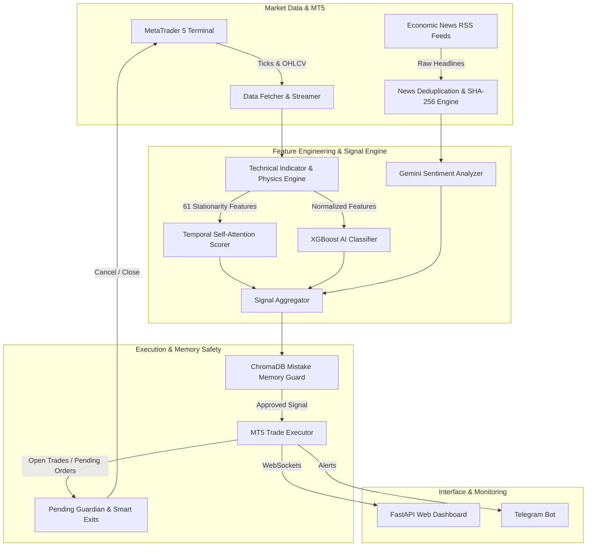

# 🏆 XAUUSD AI Trading Bot v3.2 Pro

[](https://www.python.org/downloads/)
[](https://www.metatrader5.com/)
[](https://fastapi.tiangolo.com/)
[](https://xgboost.readthedocs.io/)
[](https://ai.google.dev/)
[](CHANGELOG.md)
[](LICENSE)

An institutional-grade, capital-preserving autonomous AI trading bot designed for **XAUUSD (Gold)** on **MetaTrader 5**. Features a **Multi-Timeframe Confirmation Gate Engine**, **Dynamic Drawdown Scaling & Circuit Breakers**, **Temporal Self-Attention Market Scorer**, **Purged TimeSeriesSplit XGBoost Model**, **LLM Self-Learning & Mistake Memory Guard**, **Rollover Protection Shield**, and a **Real-Time Web Dashboard** with live TradingView position overlays.

---

## 📑 Table of Contents

- [🌟 Key Features & Innovations](#-key-features--innovations)
  - [⚡ 1. Execution Pipeline Integrity & Livelock Prevention (v3.2)](#-1-execution-pipeline-integrity--livelock-prevention-v32)
  - [🛡️ 2. Institutional Capital Protection & Resilience Engine (v3.1)](#️-2-institutional-capital-protection--resilience-engine-v31)
  - [🧠 3. Regularized Purged TimeSeriesSplit XGBoost Engine](#-3-regularized-purged-timeseriessplit-xgboost-engine)
  - [🧠 4. Temporal Self-Attention Market Scorer](#-4-temporal-self-attention-market-scorer)
  - [📊 5. Candlestick Physics & Stationarity Engine](#-5-candlestick-physics--stationarity-engine)
  - [🧠 6. Autonomous Self-Learning & Mistake Memory Guard](#-6-autonomous-self-learning--mistake-memory-guard)
  - [🛡️ 7. Pending Order Guardian & Smart Midway Exits](#️-7-pending-order-guardian--smart-midway-exits)
  - [📰 8. Multi-Layer News & Sentiment Deduplication](#-8-multi-layer-news--sentiment-deduplication)
  - [📈 9. Interactive Real-Time Web Dashboard](#-9-interactive-real-time-web-dashboard)
  - [📱 10. Telegram Remote Bot Controller](#-10-telegram-remote-bot-controller)
- [🏗️ System Architecture](#️-system-architecture)
- [📂 Project Structure](#-project-structure)
- [🔑 Credentials & API Setup Guide](#-credentials--api-setup-guide)
  - [1. MetaTrader 5 Account & Terminal](#1-metatrader-5-account--terminal)
  - [2. Google Gemini AI API Key](#2-google-gemini-ai-api-key)
  - [3. Telegram Bot Token & Chat ID](#3-telegram-bot-token--chat-id)
  - [4. Financial News APIs (Optional / Supplementary)](#4-financial-news-apis-optional--supplementary)
  - [5. Web Dashboard Credentials](#5-web-dashboard-credentials)
- [⚡ Installation & Setup Guide](#-installation--setup-guide)
  - [1. Prerequisites](#1-prerequisites)
  - [2. Clone Repository & Install Dependencies](#2-clone-repository--install-dependencies)
  - [3. Configure Environment Variables](#3-configure-environment-variables)
- [🚀 Running the Bot](#-running-the-bot)
  - [🔄 Auto-Start on PC Boot (Background Daemon)](#-auto-start-on-pc-boot-background-daemon)
  - [Start Full Suite (Trading Bot + Web Dashboard + Telegram Bot)](#start-full-suite-trading-bot--web-dashboard--telegram-bot)
  - [Start Trading Bot Only (Headless)](#start-trading-bot-only-headless)
  - [🛑 Managing Background Processes](#-managing-background-processes)
  - [Retrain XGBoost AI Model](#retrain-xgboost-ai-model)
  - [Run Diagnostic System Audit & Automated Tests](#run-diagnostic-system-audit--automated-tests)
  - [🔬 Run Multi-Timeframe Historical Backtests](#-run-multi-timeframe-historical-backtests)
- [📱 Telegram Commands & Controls](#-telegram-commands--controls)
- [❓ Frequently Asked Questions (FAQ)](#-frequently-asked-questions-faq)
- [🛡️ Risk & Safety Disclaimer](#️-risk--safety-disclaimer)
- [📜 License](#-license)

---

## 🌟 Key Features & Innovations

### ⚡ 1. Execution Pipeline Integrity & Livelock Prevention (v3.2)
Engineered to guarantee continuous, deadlock-free execution in all market environments:
- **Proportional Neutral Feed Scaling**: Eliminates mathematical deadlocks when AI prediction is `HOLD` or news sentiment is neutral. Dynamically scales confluence target (from 50.0 to ~42.5), allowing strong technical setups to execute cleanly without artificial stalls.
- **Ranging Regime Directional Neutrality**: Configures `RANGING` market regimes as trend-neutral (`trend_direction = "NEUTRAL"`), enabling two-way oscillating execution (buying support and selling resistance) without false counter-trend vetoes.
- **Lossless Trade Strategy & Regime Attribution**: Guarantees persistence of strategy names and trade context across external MT5 deal synchronizations and trailing stop closures, eliminating misattribution between day trading and scalping.
- **Time-Decay Rehabilitation Engine**: Automatically rehabilitates penalized strategies dormant for >12 hours back towards baseline `1.0` multiplier, preventing permanent learning lockouts.
- **Responsive Multi-Timeframe Trend Gates**: Employs directional ADX and fast EMA20/EMA50 alignment across M5, H1, H4, and D1 to align strategy setup generation with live macro regimes.

### 🛡️ 2. Institutional Capital Protection & Resilience Engine (v3.1)
Built specifically to eliminate catastrophic drawdowns and counter-trend loss streaks on gold:
- **Multi-Timeframe Trend Gates (MTF)**:
  - **M5 Scalping**: Must align with H1 trend (EMA 20 vs EMA 50) and blocks entries during low-volume Asian hours (`vol_intensity < 1.0` during 21:00-07:00 UTC).
  - **H1 Day Trading**: Requires H4 macro trend alignment before entering. Counter-trend pullbacks into falling knives are strictly vetoed.
  - **H4 Swing Trading**: Requires D1 macro trend alignment (D1 EMA 20 vs EMA 50).
- **Dynamic Drawdown Position Halving & Freeze**:
  - **5% Drawdown**: Risk per trade is cut by 50% and max lot size is capped at 50%.
  - **10% Drawdown**: Hard trading freeze blocks all new entries until equity recovers.
- **Loss-Streak Circuit Breakers**:
  - 3 consecutive losses on any strategy triggers an exponential cooldown (`15m -> 30m -> 60m -> 120m`).
  - Asymmetric confidence decay (0.78x multiplier drop on loss, 1.03x recovery on win).
  - 2-hour auto-probation timeout on win-rate suspensions so strategies can re-qualify after market regimes shift.
- **Market Rollover Shield**: Blocks new trade execution between 21:00-22:00 UTC to protect against massive spread spikes.

### 🧠 3. Regularized Purged TimeSeriesSplit XGBoost Engine
- **Anti-Overfitting Regularization**: 300 estimators, `gamma=0.3`, `reg_alpha=0.5`, `reg_lambda=2.0`, `min_child_weight=5`.
- **Purged Cross-Validation**: 5-fold `TimeSeriesSplit` with a 20-bar purge gap to completely eliminate look-ahead data leakage.
- **Uncertainty Margin Gate**: Directional calls require at least a 10% probability margin between top classes, otherwise defaulting safely to `HOLD`.

### 🧠 4. Temporal Self-Attention Market Scorer
Inspired by official MQL5 Algorithmic Trading Neural Network research:
- **Scaled Dot-Product Self-Attention**: Quantifies inter-period query/key relationships across multi-scale rolling feature windows (M1, M5, M15, H1).
- **Attention Concentration Index (ACI)**: Measures weight dispersion to detect regime switches, market compression, and breakout conviction.
- **Dynamic Threshold Adaptation**: Automatically tightens or loosens trade entry confidence requirements based on real-time market entropy.

### 📊 5. Candlestick Physics & Stationarity Engine
Processes 61 normalized features computed on every tick/candle:
- **Anatomy Ratios**: `candle_body_ratio`, `upper_wick_ratio`, `lower_wick_ratio`, and `candle_conviction`.
- **Stationarity Transformation**: Z-score normalized log-returns (`log_return_zscore_20`) preventing non-stationary drift.
- **Volume & Force Metrics**: `volume_intensity` and `effort_result_ratio` to validate institutional liquidity surges.

### 🧠 6. Autonomous Self-Learning & Mistake Memory Guard
- **Trade Post-Mortem Analysis**: Powered by Google Gemini LLM to analyze every losing trade.
- **Vector Database Memory**: Stores failure context in local `ChromaDB`.
- **Fuzzy Regime Family Matching**: Maps mistakes across broader regime families (`BEARISH`, `BULLISH`, `RANGING`, `VOLATILE`) to prevent repeating historic bad entries in similar market states.

### 🛡️ 7. Pending Order Guardian & Smart Midway Exits
- **Limit/Stop Order Guardian**: Continuously evaluates pending orders against shifted technical indicators or high-impact news, autonomously canceling obsolete limit orders.
- **Smart Midway Exits**: Monitors active position health, trailing stop loss based on ATR volatility, and exiting early if market sentiment flips sharply against open positions.

### 📰 8. Multi-Layer News & Sentiment Deduplication
- **SHA-256 Canonical Hashing**: Prevents redundant processing of duplicate RSS headlines across sources.
- **Temporal & Normalized Matching**: Strips timestamps, dynamic numbers, and source tags to eliminate repetitive news notifications and sentiment bias.
- **Impact Classification**: Integrates high-impact economic calendar events directly into signal filtering.

### 📈 9. Interactive Real-Time Web Dashboard
- **Live TradingView Position Overlay**: View real-time XAUUSD price action with interactive lines showing open `BUY`/`SELL` entries, Stop Loss, and Take Profit levels.
- **Streaming Metrics**: WebSocket-powered live P&L, balance, equity, win rate, drawdown, and risk meter.
- **Interactive Control Modal**: Quick regime inspection, model barometer score breakdown, and system status toggles.

### 📱 10. Telegram Remote Bot Controller
- **Interactive Keyboards**: Quick menu buttons for status, balance, manual trade triggers, and regime breakdown.
- **Commands**: `/regime`, `/status`, `/balance`, `/closeall`, `/cancelall`, `/help`.
- **Real-Time Push Notifications**: instant trade placement, pending order execution, stop loss hits, and news summary alerts.

---

## 🏗️ System Architecture



---

## 📂 Project Structure

```
XAUUSD-AI-Trading-Bot/
├── ai/                        # Machine Learning & Attention Scorer
│   ├── attention_scorer.py    # Temporal Self-Attention & Concentration Index
│   ├── classifier.py          # XGBoost Model Loading & Inference
│   ├── self_learning.py       # Gemini LLM Trade Post-Mortem & Vector DB Memory
│   └── models/                # Saved XGBoost (.json/.pkl) & Scalers
├── analysis/                  # Technical Indicators & Market Physics
│   ├── technical.py           # 61 Stationarity Features & Candlestick Anatomy
│   └── regime_detector.py     # Volatility, Trend & Entropy Regime Detection
├── config/                    # Configuration Files
│   ├── settings.py            # Central System Configuration & Parameters
│   └── .env                   # Environment Variables & API Keys
├── core/                      # Core Trading Engine
│   ├── bot.py                 # Main Trading Bot Orchestrator
│   ├── executor.py            # MT5 Trade Placement, SL/TP & Orders
│   ├── models.py              # Data Models (Signal, Trade, Regime)
│   └── mt5_interface.py       # MetaTrader 5 API Wrapper
├── dashboard/                 # Real-Time Web Interface
│   ├── app.py                 # FastAPI Web Server & API Routes
│   ├── templates/             # HTML Dashboard UI
│   └── static/                # CSS, JavaScript (Chart.js & TradingView)
├── database/                  # SQLite Database Storage
│   └── crud.py                # Trade History, System Logs & Metrics Persistence
├── news/                      # News & Sentiment Engine
│   ├── fetcher.py             # RSS Economic News Scraper
│   ├── news_utils.py          # SHA-256 Headline Normalization & Deduplication
│   └── analyzer.py            # Gemini Sentiment Analysis
├── notifications/             # Remote Telegram Interface
│   ├── telegram_bot.py        # Telegram Bot Commands & Async Handlers
│   └── keyboards.py           # Interactive Inline Keyboard Menus
├── scripts/                   # Training & Utility Scripts
│   └── train_ai.py            # XGBoost Model Training Script (10,000 candles)
├── audit_full_system.py       # System Diagnostic & End-to-End Verification
├── main.py                    # Application Entry Point
├── README.md                  # Project Documentation
└── requirements.txt           # Python Dependencies
```

---

## 🔑 Credentials & API Setup Guide

This section provides step-by-step instructions and official links to gather all accounts, credentials, and API keys needed to populate `config/.env`.

### 1. MetaTrader 5 Account & Terminal
The bot communicates directly with the desktop MetaTrader 5 terminal via the Python `MetaTrader5` library.

- **Broker Account**:
  - Sign up with a broker supporting MetaTrader 5 and XAUUSD trading (e.g., [Exness](https://www.exness.com/), [IC Markets](https://www.icmarkets.com/), [Tickmill](https://www.tickmill.com/), etc.).
  - Create an **MT5 Demo Account** (recommended for testing) or Live Account.
  - From your broker client portal or confirmation email, locate:
    - **`MT5_LOGIN`**: Your numeric account login (e.g., `12345678`).
    - **`MT5_PASSWORD`**: Trading master password for this account.
    - **`MT5_SERVER`**: The exact server name specified by your broker (e.g., `Exness-MT5Trial6` or `ICMarketsSC-Demo`).
- **Desktop Terminal**:
  - Download and install MetaTrader 5: [MetaTrader 5 Official Download](https://www.metatrader5.com/en/download).
  - Note your executable installation path for **`MT5_PATH`** (defaults to `C:\Program Files\MetaTrader 5\terminal64.exe`).
  - Open MT5, log into your account, and navigate to **Tools -> Options -> Expert Advisors**:
    - Check **"Allow Algo Trading"**.
    - (Optional) Uncheck "Disable Algo Trading when account/profile has been changed".

### 2. Google Gemini AI API Key
Used for news sentiment scoring, trade post-mortem self-learning, and the mistake memory guard.

- **Portal**: [Google AI Studio](https://aistudio.google.com/)
- **Steps**:
  1. Sign in with your Google account.
  2. Click on **"Get API key"** (or navigate to [API Keys](https://aistudio.google.com/app/apikey)).
  3. Click **"Create API key"** and choose or create a Google Cloud project.
  4. Copy the generated key and assign it to **`GEMINI_API_KEY`**.

### 3. Telegram Bot Token & Chat ID
Enables real-time trade signals, performance telemetry, and remote interactive commands (`/status`, `/regime`, `/balance`, `/closeall`).

- **Telegram Bot Token (`TELEGRAM_BOT_TOKEN`)**:
  1. Open Telegram and search for the official [@BotFather](https://t.me/BotFather).
  2. Start a chat and send `/newbot`.
  3. Enter a display name and unique username ending in `bot` (e.g., `MyGoldTradingBot`).
  4. BotFather will provide an API token formatted like `123456789:ABCdefGhIJKlmNoPQRsTUVwxyZ`.
- **Telegram Chat ID (`TELEGRAM_CHAT_ID`)**:
  1. Open your newly created bot in Telegram and click **Start** (or send any text message to it).
  2. To get your numeric user or group Chat ID:
     - Search and start [@userinfobot](https://t.me/userinfobot) or [@IDBot](https://t.me/myidbot), which will reply with your `Id` (e.g., `987654321`).
     - Alternatively, open your browser and visit:  
       `https://api.telegram.org/bot<YOUR_BOT_TOKEN>/getUpdates`  
       Look for `"chat":{"id": 987654321}` in the returned JSON.
  3. Set this ID as **`TELEGRAM_CHAT_ID`**.

### 4. Financial News APIs (Optional / Supplementary)
The bot incorporates economic calendar RSS feeds out-of-the-box. You can optionally add dedicated news API keys for higher coverage:

- **Finnhub (`FINNHUB_API_KEY`)**:
  - Register at [Finnhub.io](https://finnhub.io/).
  - Obtain a free API key from your [Finnhub Dashboard](https://finnhub.io/dashboard).
- **Alpha Vantage (`ALPHA_VANTAGE_API_KEY`)**:
  - Claim a free key at [Alpha Vantage](https://www.alphavantage.co/support/#api-key).

### 5. Web Dashboard Credentials
Used to protect the local/remote FastAPI monitoring web portal:

- **`DASHBOARD_SECRET_KEY`**: Set a strong random string (e.g., generated with `python -c "import secrets; print(secrets.token_hex(32))"`).
- **`DASHBOARD_USERNAME`**: Default is `admin` (or any custom username).
- **`DASHBOARD_PASSWORD`**: Strong password to log into the web dashboard at `http://127.0.0.1:8080`.

---

## ⚡ Installation & Setup Guide

### 1. Prerequisites
- **Operating System**: Windows 10 / 11 (Required for MetaTrader 5 Python API).
- **Python**: Python 3.10 or higher.
- **MetaTrader 5**: Installed with an active Demo or Live trading account (Exness, IC Markets, etc.). Ensure **"Allow Algo Trading"** is enabled in MT5 `Tools -> Options -> Expert Advisors`.

### 2. Clone Repository & Install Dependencies
```bash
git clone https://github.com/YourUsername/XAUUSD-AI-Trading-Bot.git
cd XAUUSD-AI-Trading-Bot

# Create virtual environment
python -m venv venv
venv\Scripts\activate

# Install dependencies
pip install -r requirements.txt
```

### 3. Configure Environment Variables
Copy `config/.env.example` to `config/.env` and update with the credentials retrieved above:
```bash
copy config\.env.example config\.env
```
Example `.env`:
```env
# MetaTrader 5 Credentials
MT5_LOGIN=12345678
MT5_PASSWORD=YourPasswordHere
MT5_SERVER=Exness-MT5Trial6
MT5_PATH=C:\Program Files\MetaTrader 5\terminal64.exe

# Telegram Bot Integration
TELEGRAM_BOT_TOKEN=123456789:ABCdefGhIJKlmNoPQRsTUVwxyZ
TELEGRAM_CHAT_ID=987654321

# Google Gemini API Key (For Sentiment & Self-Learning Memory)
GEMINI_API_KEY=AIzaSyYourGeminiApiKeyHere

# News APIs (Optional)
FINNHUB_API_KEY=your_finnhub_key_here
ALPHA_VANTAGE_API_KEY=your_alpha_vantage_key_here

# Web Dashboard Security
DASHBOARD_SECRET_KEY=generate_a_random_secret_key_here
DASHBOARD_USERNAME=admin
DASHBOARD_PASSWORD=your_secure_password

# Database (Default local SQLite)
DATABASE_URL=sqlite:///./data/trading_bot.db
```

---

## 🚀 Running the Bot

### 🔄 Auto-Start on PC Boot (Background Daemon)
To configure the bot to automatically start actively trading in the background whenever your PC boots up:
1. Double-click `install_startup_service.bat`.
2. The bot will automatically launch in **Active Trading** mode (live or demo) upon startup and connect to MT5.
3. You can pause, monitor, or stop it anytime using the Telegram remote controller on your phone.

### Start Full Suite (Trading Bot + Web Dashboard + Telegram Bot)
```bash
python main.py --dashboard
```
- **Web Dashboard**: Access at [`http://127.0.0.1:8080`](http://127.0.0.1:8080)
- **Telegram Bot**: Active and responding to chat commands.

### Start Trading Bot Only (Headless)
```bash
python main.py
```

### 🛑 Managing Background Processes
- **Stop Trading Bot Cleanly**: Double-click `stop_bot.bat` (safely terminates only the bot process without affecting any other desktop windows).
- **Toggle MetaTrader 5 Terminal Visibility**: Double-click `toggle_mt5.bat` or send `/show_mt5` / `/hide_mt5` from Telegram to toggle MT5 charts visible or hidden on your desktop.

### Retrain XGBoost AI Model
To fetch fresh M5/M15 historical data from MT5 and train the XGBoost classifier on 10,000 candles:
```bash
python scripts/train_ai.py
```

### Run Diagnostic System Audit & Automated Tests
To run the automated test suite verifying trading rules, regime detection, risk management, and security:
```bash
python -m pytest tests/ -v
```
To test MT5 connectivity, Gemini LLM API, News Deduplication, Web Dashboard, and Self-Attention Engine:
```bash
python audit_full_system.py
```

### 🔬 Run Multi-Timeframe Historical Backtests
Simulate trading strategies on real historical MT5 price action with higher-timeframe trend confirmation:
```bash
# Detailed audit on recent real MT5 market data (M5 & H1 multi-TF)
python scripts/backtest_last_week_detailed.py

# Multi-strategy benchmark comparison
python scripts/run_recent_backtest.py
```

---

## 📱 Telegram Commands & Controls

| Command | Description |
| :--- | :--- |
| `/start` | Launch interactive menu and main dashboard overview |
| `/status` | Check live bot operational health, open trades, and MT5 connection |
| `/regime` | View real-time Market Regime, Volatility, and Self-Attention score |
| `/balance` | View Account Equity, Free Margin, and Floating P&L |
| `/closeall` | Immediately emergency close all open positions |
| `/cancelall` | Cancel all active pending limit/stop orders |
| `/help` | View help and command reference |

---

## ❓ Frequently Asked Questions (FAQ)

### What is the XAUUSD AI Trading Bot?
The XAUUSD AI Trading Bot is an institutional-grade, quantitative algorithmic trading system engineered for MetaTrader 5. It trades Gold (XAUUSD) using regularized XGBoost classification, temporal self-attention market scoring, and Google Gemini LLM trade post-mortem analysis.

### How does the bot prevent overfitting and look-ahead bias?
The machine learning pipeline implements a 5-fold Purged TimeSeriesSplit with a 20-bar purge buffer between train and test windows, eliminating data leakage from future candles into model predictions.

### How does the system handle high-volatility events and drawdowns on Gold?
The bot enforces multi-layered risk protocols:
- Dynamic drawdown position halving at 5% drawdown and a hard freeze at 10% drawdown.
- Consecutive loss circuit breakers that enforce exponential cooldown intervals (15m to 120m).
- Market rollover shield preventing trade entry between 21:00 and 22:00 UTC when broker spreads widen drastically.

### Can the bot run 24/7 without manual intervention?
Yes. The system runs fully autonomously on a Windows VPS or local machine with direct MetaTrader 5 execution, Telegram notification alerts, and a FastAPI web dashboard for remote telemetry.

---

## 🛡️ Risk & Safety Disclaimer

> [!WARNING]
> Trading Forex and Gold (XAUUSD) involves substantial risk of loss and is not suitable for all investors. Past performance of algorithmic or machine learning models is not indicative of future results. Always test thoroughly on a **Demo Account** before deploying live capital.

---

## 📜 License
This project is licensed under the [MIT License](LICENSE).
